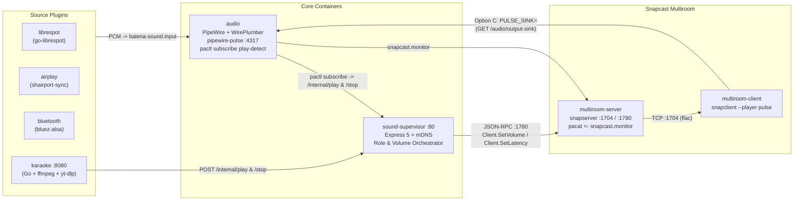

# IoTSound — AI Agent & Maintainer Guide (`AGENTS.md` / `CLAUDE.md`)

IoTSound (`JaragonCR/iotsound`) is a multi-container balena audio streaming and karaoke platform for Raspberry Pi (Pi 3, Pi 4, Pi 5) and x86 devices. It combines PipeWire + WirePlumber (`pipewire-pulse` on TCP `4317`), Snapcast multiroom audio, Spotify Connect (`go-librespot`), AirPlay 2 (`shairport-sync`), Bluetooth (`bluez-alsa`), and a self-hosted Go Karaoke web app (`plugins/karaoke/app`).

---

## 1. Fast-Path Architecture Pack (Read First)

Before scanning the entire repository, read these compact architecture documents in order:

1. [`docs/architecture/ai-index.md`](docs/architecture/ai-index.md) — Core invariants and minimal debugging context.
2. [`docs/architecture/system-map.md`](docs/architecture/system-map.md) — Container topology, ports, volumes, and control vs. audio planes.
3. [`docs/architecture/runtime-states.md`](docs/architecture/runtime-states.md) — Role state machine (`WARM`, `SOURCING`, `SLAVE`, `SOLO`, `disabled`) and sequence diagrams.
4. [`docs/architecture/audio-flow.md`](docs/architecture/audio-flow.md) — End-to-end signal paths, Option C direct hardware output, and buffer reference table.
5. [`docs/architecture/ownership-map.md`](docs/architecture/ownership-map.md) — Exact file ownership by concern, symptom, and environment variable.
6. [`docs/architecture/mdns.md`](docs/architecture/mdns.md) — Avahi/mDNS discovery and IPv4 LAN filtering rules.
7. [`docs/architecture/ai-prompt.md`](docs/architecture/ai-prompt.md) — Copy/paste debugging prompt and diagnostic command bundle.

---

## 2. System Topology & Audio Signal Flow

---

## 3. Core Invariants (Do Not Break)

1. **`audio` (`core/audio/`):**
   - Runs PipeWire + WirePlumber on Alpine 3.23 and exposes `pipewire-pulse` on `tcp:localhost:4317`.
   - Creates three virtual null sinks in `balena-sound.pa`: `balena-sound.input` (default sink for all plugins), `snapcast` (multiroom capture sink), and `balena-sound.output` (used only for `disabled` standalone and `SOLO` fallback).
   - Detects sink-inputs on `balena-sound.input` via a `pactl subscribe` bash loop in `core/audio/start.sh` (Phase 10) and posts `/internal/play` and `/internal/stop` to `sound-supervisor`.
   - Keep `AUDIO_OUTPUT=AUTO` by default; `start.sh` and `PulseAudioWrapper.getHardwareSink()` support `AUTO`, 1-based index (`1`, `2`), or sink substring matching.

2. **Direct-to-Hardware Multiroom Output (Option C):**
   - `multiroom-client` queries `GET /audio/output-sink` on `sound-supervisor` and sets `PULSE_SINK=<HW_SINK>` so `snapclient` plays **directly to the hardware ALSA sink** (bypassing `balena-sound.output`).
   - This exposes the real hardware DAC latency to PipeWire and Snapcast so heterogeneous devices stay in sync without manual per-device latency tuning.

3. **In-Place Transient Source-Master (`WARM` / `SOURCING` / `SLAVE` / `SOLO`):**
   - `auto` and `host` pre-warm `multiroom-server` and `multiroom-client` at startup. State transitions happen **in place** without restarting containers:
     - `multiroom-server` holds `/tmp/snapserver-audio` FIFO open and starts/stops `pacat` based on `GET /multiroom/active`.
     - `multiroom-client` polls `GET /multiroom/client-ready` and `GET /multiroom/master` and respawns `snapclient` in place when the master IP changes.
   - Master conflict resolution uses **newest-`epoch` wins** (`master_uuid` lexicographical tie-breaker) in both `onMasterUp()` and `selectedMaster()`.

4. **Single Volume Authority (Option B):**
   - **When multiroom is active** (`role !== 'disabled' && !isSolo() && monitor.hasActiveMultiroomTarget()`): local hardware sinks are locked to **`100%` (unity gain)** via `setHardwareUnityGain()`, and `GET`/`POST /audio/volume` reads and writes Snapcast `Client.SetVolume` (JSON-RPC `:1780`) on the active master (`localhost` when sourcing, `discoveredMasterIp` when slave).
   - **When multiroom is off / idle / SOLO:** `GET`/`POST /audio/volume` controls the local PipeWire sink (`audioBlock.setVolume()` / `getVolume()`) directly.

5. **Single-Container Karaoke (`plugins/karaoke/app/`):**
   - Runs as a single Go container on port `8080` with `ffmpeg` and `yt-dlp` installed locally (with a background 24h `yt-dlp -U` self-updater).
   - Serves pre-downloaded MP4s via HTTP range requests at `/stream/current` (no HLS transcoding).
   - In `local` speaker mode, streams audio via `ffmpeg` to `balena-sound.input`, notifies `/internal/play` & `/internal/stop`, and loads a mic loopback (`source=<mic> sink=balena-sound.input`) **only while a song is actively playing**.

---

## 4. Fleet, Hardware & Workflow Rules

- **Repository:** `https://github.com/JaragonCR/iotsound` (default branch: `master`).
- **Balena Fleet:** `g_jorge_aragon/sound`
  - **Device 1:** `554b996` (`wispy-road`) — Raspberry Pi 4 (`raspberrypi4-64`).
  - **Device 2:** `a1d8943` (`pretty-apple`) — Raspberry Pi 3 (`raspberrypi3-64`).
- **Development & Release Workflow:**
  - Always work on a feature/fix branch, create clean commits, validate on local devices using `balena-cli` (`balena push g_jorge_aragon/sound`), open a PR against `master`, and squash-merge after verification.
  - **Versionist Requirement:** Every commit in a PR **must** end with a `Change-type: patch` (or `minor` / `major`) trailer in the commit footer so CI / Versionist can calculate the next semantic version.
