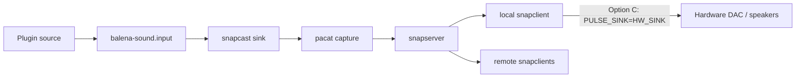
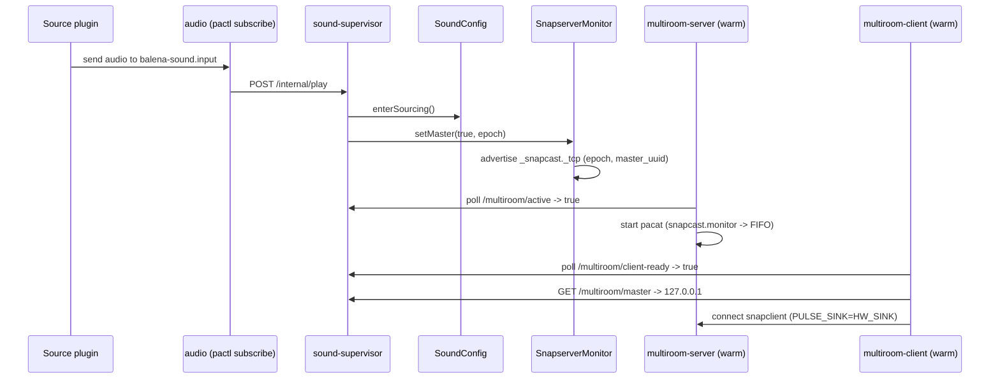
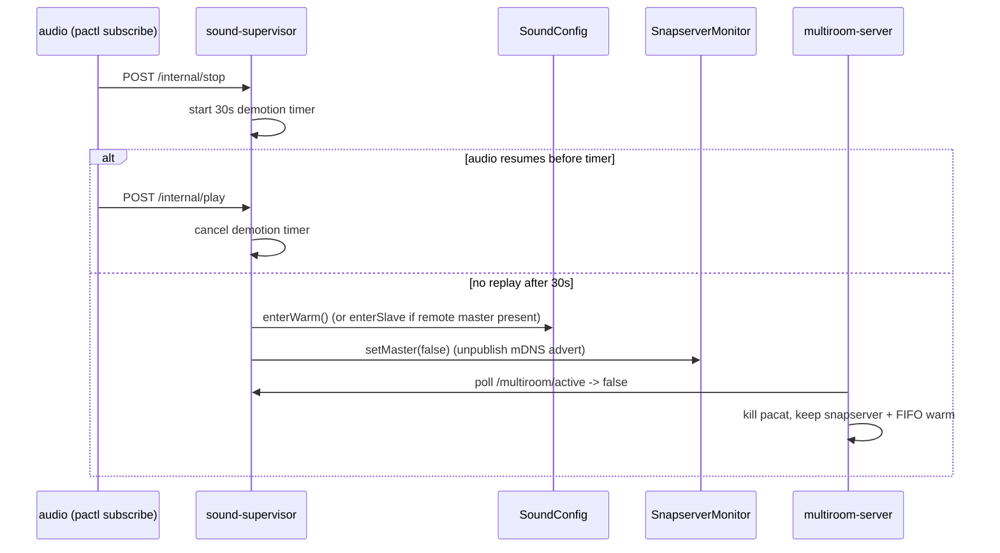
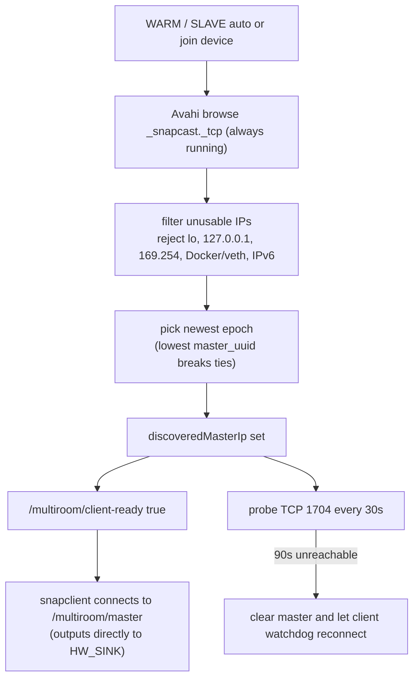

# Runtime States

`SOUND_MULTIROOM_ROLE` is configuration. Runtime state is what the device is doing right now.

## Role matrix

| Configured role | Source plugins | Runs `multiroom-server` | Runs `multiroom-client` | Can become master | Typical use |
|---|---|---:|---:|---:|---|
| `auto` | yes | pre-warmed, active after promotion | pre-warmed, active after target exists | yes, on first play | Normal devices. |
| `host` | yes | yes | yes | always | Dedicated source/master device. |
| `join` | no | no | yes | no | Passive speaker. |
| `disabled` | yes | no | no | no | Independent standalone room. |

## Runtime audio paths

### Disabled standalone

Owner notes:

- Configured by `core/audio/start.sh` when role is `disabled`.
- `sound-supervisor` stops both multiroom services and starts source plugins.

### Multiroom master with local playback (`SOURCING`)

Owner notes:

- The master hears itself through its own local `snapclient`, which outputs directly to the detected hardware sink (`GET /audio/output-sink`) with the local hardware sink locked at `100%` unity gain and volume controlled via Snapcast `Client.SetVolume`.
- `multiroom-server` polls `/multiroom/active` and starts/stops `pacat` in place while keeping `snapserver` and `/tmp/snapserver-audio` warm.
- `multiroom-client` polls `/multiroom/client-ready`, fetches `/multiroom/master`, and respawns `snapclient` in place if the master IP changes.

### Remote client playback (`SLAVE`)

Owner notes:

- `join` devices live here all the time.
- `auto` devices live here when another device in the group is sourcing.
- Source plugins are stopped for `join`, but remain active for `auto`.
- Local hardware sink is locked at `100%` unity gain; `GET`/`POST /audio/volume` proxies to the remote master's Snapcast `Client.SetVolume` on `:1780`.

### Simultaneous-source conflict fallback (`SOLO`)

Owner notes:

- Triggered only when two devices in the same group start playing local sources at the exact same epoch and this device loses the `master_uuid` tie-breaker (or loses to a newer `epoch` while still playing locally).
- Implemented by unloading the `balena-sound.input -> snapcast` loopback and loading `balena-sound.input -> balena-sound.output`.
- On stop (`/internal/stop`), supervisor restores `balena-sound.input -> snapcast` and returns to `WARM` (or `SLAVE` if a remote master is still active).

## Promotion and demotion sequence (in-place, no container restarts)

## Stop sequence (in-place demotion)

## Discovery state

## State names to use in issues

Use these names in debugging notes and prompts:

- `disabled-standalone`
- `auto-idle`
- `auto-master-snapcast`
- `auto-master-direct-fallback`
- `auto-remote-client`
- `host-master`
- `join-remote-client`

These names prevent ambiguity around the word "local".
